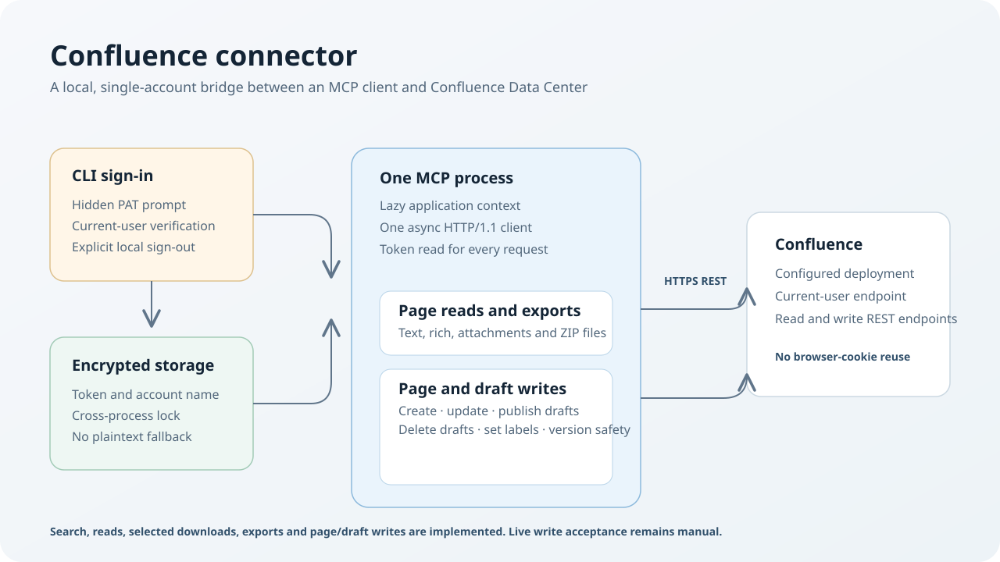

# Confluence connector

Local MCP connector for one user's Confluence Data Center account. The current release provides
encrypted token setup, account status, space listing, content search, user lookup, page trees and page
metadata, budgeted page-text reads, selected attachment downloads and batch page exports. The
remaining product scope is in the [requirements](docs/requirements.md) and [roadmap](docs/roadmap.md).

| Document | Purpose |
|---|---|
| [Requirements](docs/requirements.md) | Agreed scope, capabilities and ownership |
| [Architecture](docs/architecture.md) | Current code and implemented contracts |
| [Roadmap](docs/roadmap.md) | Open implementation and live-verification work |
| [API research](docs/api-research.md) | Dated evidence and limitations |
| [Research toolkit](research/README.md) | Explicit manual probes and UI investigation |

## Current MCP tools

- `auth_status` reports whether a token is stored and which account name it is bound to. It is offline;
  use the CLI's `status --check` to verify that Confluence still accepts the token.
- `list_spaces` lists current and archived spaces visible to the stored account, including their name,
  key, type, status and link when Confluence supplies one. It follows the server's actual
  `start + size` paging and requests up to 500 spaces at a time.
- `search_content` performs literal, scoped content or title searches with stateless continuation
  cursors. Archived spaces are included by default; title searches can add labelled quick-navigation
  results when no additional filters are set.
- `find_users` resolves current users by display name and former users by exact username.
- `get_page_tree` returns ordered children and ancestors from a page or space root with bounded depth.
- `get_page_metadata` returns history, retained versions, labels, contributors and ancestors for up
  to 20 page references.
- `get_pages` returns up to 20 page IDs or same-instance URLs as Markdown-like text or unchanged
  storage markup. Text reads include typed references, attachment lists, and threaded comments by
  default; attachments are not downloaded. A character budget packs whole pages and uses a
  version-pinned cursor when the first page needs continuation.
- `download_attachments` saves selected attachment IDs from one page to the local downloads folder.
  It verifies each ID belongs to that page and returns a path or per-attachment failure.
- `export_pages` writes up to 500 pages in full as text or rich HTML. One clean page can be a single
  timestamped file; multi-page, incomplete or attachment-inclusive exports are ZIPs. Attachment bytes
  are excluded by default, and `_export-report.txt` records page or attachment failures. Large exports
  may take minutes. The provenance header is always included.

Page and draft changes remain open work.
Authentication is separate from Microsoft 365 sign-in.

## Setup

Requires Python 3.12+ and `uv`. Copy `confluence_config.example.json` to the ignored
`confluence_config.json`, then set the deployment URL and relative API paths. The probe query and form
login path are used only by the separate research toolkit. The optional `cql_timezone` accepts an
IANA timezone name or a fixed `UTC±HH:MM` offset; it is `null` in the example and may be populated by
the CLI calibration described below.

From the repository root:

```powershell
uv sync --locked
uv run confluence-connector auth
uv run confluence-connector status --check
```

`auth` prompts for a personal access token without echoing it, checks it against the configured
current-user endpoint, then stores the token and account name in encrypted per-user storage. It then
calibrates CQL's effective timezone with read-only searches. If `cql_timezone` is unset, `auth` and
`status --check` write the measured offset to the private config atomically while preserving its other
settings. The written fixed offset does not follow daylight saving; replace it with an IANA name when
your Confluence timezone observes daylight-saving changes. `status --check` compares a configured
timezone with the current measurement and warns on a mismatch without changing it. Calibration runs
only when you explicitly run `auth` or `status --check`, never when MCP starts. If encrypted storage is
unavailable, the command fails without a plaintext fallback. To clear the local token, run
`uv run confluence-connector auth --sign-out`; this does not revoke the token on the server.

`search_content` accepts date-only values as calendar days in Confluence's timezone and ISO-8601
timestamps as instants. Mixed date and timestamp bounds are checked against the full local calendar
day. Timestamps without offsets mean UTC; timestamp filters require a calibrated `cql_timezone`
setting.

Configuration precedence is `--config PATH`, `CONFLUENCE_CONFIG`, then the repository-root
`confluence_config.json`, independent of the working directory. Every command supports `--config`.
Validated settings are cached per process, so restart MCP processes after editing or after a CLI
calibration updates the config. API paths are relative to the configured base URL, including an
installation context such as `/wiki`.

## MCP client configuration

Use command `uv` and these arguments, replacing both paths with absolute local paths:

```json
{
  "mcpServers": {
    "lrh-confluence-connector": {
      "command": "uv",
      "args": [
        "run",
        "--directory",
        "C:\\path\\to\\lrh-confluence-connector",
        "confluence-connector",
        "--config",
        "C:\\path\\to\\lrh-confluence-connector\\confluence_config.json",
        "mcp"
      ]
    }
  }
}
```

## Research and checks

Live probes are manual and require authorization for the requested operations. The [research toolkit](research/README.md)
explains its modes; the [UI runbook](research/ui-runbook.md) starts with search and page reading.
Browser form login is an isolated research option, not the application authentication backend.

Run offline checks from the repository root:

```powershell
uv run python -m unittest discover -s tests
uv run python -m compileall -q src research tests
uv run python research/probe_auth.py --help
```

Keep deployment settings, tokens, cookies, page content, HARs and downloaded resource bundles outside
Git. Tests and fixtures use synthetic content only.
