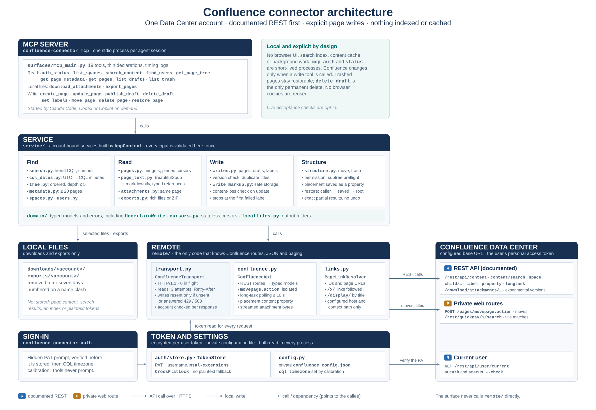

# Confluence Connector — Architecture

**Inputs:** [Requirements](requirements.md) · [Roadmap](roadmap.md) · [API research](api-research.md)

The classes and who calls whom, in more detail: [code map](diagrams/code-map.svg) (open it in a browser
for the tooltips). The diagrams give the overview; this document records the rules and contracts the code
and diagrams cannot show. *What* the connector must do is in the requirements; *why* each route was
chosen is in the research.

---

## 1. Principles

1. **Remote first.** Confluence does the searching, rendering and paging. The connector keeps no index,
   cache or copy of page content.
2. **No always-on service.** Every entry point is a short-lived local process, started on demand, for
   one user (§2).
3. **Thin surface, one service.** MCP tools validate arguments, call one service method and return a
   model. Domain decisions live in [`service/`](../src/confluence_connector/service/).
4. **Protocol knowledge stays at the edge.** Only [`remote/`](../src/confluence_connector/remote/)
   knows routes, Confluence JSON, paging and the private move action.
5. **Documented first, gaps filled.** Documented REST routes wherever they work; the private
   `movepage.action` and quick-navigation routes only for what REST cannot do (§6).
6. **Libraries for generic problems.** HTML parsing and Markdown conversion use BeautifulSoup and
   markdownify; the connector adds only Confluence-specific rules.
7. **Current format only.** No migrations or compatibility shims ([AGENTS.md](../AGENTS.md)).

## 2. Process model

There is no daemon. MCP runs only for its client session; `auth` and `status` are one-shot commands.

| Command | Lifetime | Does |
|---|---|---|
| `confluence-connector mcp` | One stdio process per MCP client session | Serves the 19 tools (§8) |
| `confluence-connector auth [--sign-out]` | One-shot | Prompts for a PAT, verifies and stores it, calibrates `cql_timezone`; or deletes the local token |
| `confluence-connector status [--check]` | One-shot | Offline account status; `--check` verifies the token and checks `cql_timezone` |

Every command accepts `--config PATH`. Exit codes: 0 success, 1 other errors, 2 sign-in required, 130
interrupted.

Consequences of short-lived processes:

- **Continuation needs no retained session state.** Cursors are self-contained (the normalized request plus the
  next offset or anchor) and survive a client restart.
- **No background work:** no schedulers, sync loops or warm-up. Calibration runs only inside `auth` and
  `status --check`, never on MCP startup or in a tool.
- **Concurrency is cross-process.** Several MCP processes may run at once; the token store locks across
  processes, and output files are claimed exclusively.
- **Startup is cheap.** Nothing is built before the first tool call. MCP never prompts; only `auth`
  asks for a token.

## 3. Layers

Surface → service → remote, as in the diagram. The import rules:

- [`surfaces/`](../src/confluence_connector/surfaces/) imports [`bootstrap.py`](../src/confluence_connector/bootstrap.py),
  [`domain/`](../src/confluence_connector/domain/) and the product names in
  [`config.py`](../src/confluence_connector/config.py) only. It never calls `remote/`.
- [`service/`](../src/confluence_connector/service/) imports `remote/` adapters, `domain/` and the
  shared helpers. It never sees Confluence JSON.
- [`remote/`](../src/confluence_connector/remote/) returns `domain/` models. The transport reads the
  token through the `CredentialSource` port ([`remote/ports.py`](../src/confluence_connector/remote/ports.py)).
- [`domain/`](../src/confluence_connector/domain/) imports nothing from the app.

## 4. Repository layout

The [code map](diagrams/code-map.svg) shows every package and class. Tests, with synthetic fixtures and
fake HTTP responses only, are under [`tests/`](../tests/); the research probe and the acceptance scripts
are under [`research/`](../research/README.md) and are never run as routine checks.

## 5. Module responsibilities

Only design rules that the code layout does not make obvious are listed here. Tool schemas are in §8.

### 5.1 [`auth/store.py`](../src/confluence_connector/auth/store.py)

- `TokenStore` keeps one record, the PAT, username and canonical instance URL (including installation path), in `msal-extensions` encrypted persistence
  under `CrossPlatLock`. No plaintext fallback: if encryption is unavailable, every command fails with
  `SecureStorageUnavailable`.
- Explicit sign-out clears even malformed JSON without decoding it, under the same encrypted-store lock.
- An instance mismatch is refused before sending credentials; unbound records are rejected, with no
  automatic migration. `save` refuses a different username until `sign_out`. Every request loads the record again, so a
  sign-out or account switch takes effect on the next request in every process.

### 5.2 [`remote/transport.py`](../src/confluence_connector/remote/transport.py)

- One `httpx.AsyncClient` per process: HTTP/1.1, no redirects, six connections, 10 s connect and pool
  timeouts, 30 s read and write timeouts. A process-wide semaphore keeps **six requests in flight**
  across all tool calls. JSON responses are capped at 16 MiB; downloads stream to disk.
- JSON calls and streamed downloads use the same `_exchange` attempt loop; downloads provide a
  destination stream while the transport applies the shared retry, status and account checks. Fixture
  multipart uploads use the same write policy. Decoded response snapshots omit compression headers.
- **Reads** retry up to 3 attempts on connection errors, timeouts, 429, 500, 502, 503 and 504, honoring
  `Retry-After` up to 30 s (a longer one is reported, not waited for), otherwise with short jittered
  backoff.
- **Writes** are resent only when they provably never applied: the request was never sent, or the answer
  was 429 or 503. A timeout after sending, an incomplete answer or a 504 raises `UncertainWrite` and is
  never resent.
- **Watcher notifications.** Versioned writes omit `version.minorEdit` by default; `notify_watchers=false`
  adds it as `true`. Multipart attachment writes send the equivalent form field. Routes without a
  version field leave Confluence's behavior untouched; their results say suppression is unsupported,
  with a note only when `false` was requested. Write results share the `NotificationOutcome` fields.
- **Account checks.** The username is read before and after every exchange; if it changed, the result
  is discarded (`AccountMismatch`), and for a write the outcome becomes `UncertainWrite`. The store's
  revision (its file's modification time and size, read before decrypting) is compared after the
  exchange; when it is unchanged the account cannot have changed, so the store is decrypted once per
  request. The token is never kept in memory between requests.
- **401** raises `AuthenticationRequired` (run `auth`); **403** raises `PermissionDenied` for that page
  or operation, never a sign-in problem. Error messages carry the status and Confluence's message, never
  URLs or bodies.

### 5.3 [`remote/confluence.py`](../src/confluence_connector/remote/confluence.py)

- `ConfluenceApi` is the only code that knows routes and wire fields. Configured endpoint paths come from
  the private settings, relative to `base_url` and its context path.
- **Paging** advances on the returned `start + size`, never on the echoed `limit` or `content/search`'s
  `next` link, which skip results (research §5.2). Space listing reads 500 per request; children 500;
  versions 200, at most 5,000; drafts and trash 100. The adapter validates each collection envelope;
  mapped envelopes share continuation handling and reject empty pages claiming more results. A next
  marker, top-level or under `_links`, means more results; `_links` without one ends the collection.
  Attachment and comment totals are exact, so links that end before the total raise.
- **Page reads** are three parallel requests: bodies (`view`, optional `storage`, version, history),
  attachments and comments (500 per request, at most 5,000 each; an incomplete collection raises). A requested body that is missing or
  malformed raises `Upstream`.
- **The private move action** is isolated in `position_page` and `move_page_action`: `POST
  /pages/movepage.action` with `pageId`, `spaceKey`, `position`, `targetId` and `mode`. Application
  errors in its JSON (`actionErrors`, `validationErrors`, `errorMessage`) raise. Cross-space moves use
  `ASYNC` and poll the documented `/rest/api/longtask/{id}` up to 40 times, at most 10 s; a task still
  running then is `UncertainWrite`. `successful` alone is not terminal: completion also needs
  `finished: true`, or 100 percent when `finished` is absent.
- **Exact titles** use the content collection for current and trashed pages, avoiding CQL indexing
  and quote limitations. Draft and trash listings share the collection request and envelope mapping.
- **Placement properties** (`get_page_property`, `set_page_property`, `remove_page_property`) store a
  page's former parent and position in a content property before it is trashed (research §6.4).
- **Attachment management** creates files with the page attachment route and versions existing files
  with `/child/attachment/{id}/data`; metadata uses the content update route, and removal is a soft
  delete followed by status-current restoration. Multipart writes share transport account and retry
  checks.

### 5.4 [`remote/links.py`](../src/confluence_connector/remote/links.py)

`PageLinkResolver.resolve` turns a numeric ID or a same-instance URL into a page ID and optional
version: `/spaces/KEY/pages/ID/…` and `viewpage.action?pageId=` directly; `/x/…` by following up to 5
redirects that must stay on the configured HTTPS origin and context path; `/display/KEY/Title` by an
exact-title content-collection lookup in that space. Any other host or path is refused with `InvalidRequest`.

### 5.5 [`domain/`](../src/confluence_connector/domain/)

- Pydantic models are the only schema: FastMCP derives the tool schemas from them.
- Shared page-reference, space-key and current-page checks live in `validation.py`; CQL quoting and
  same-instance URL rules live in `cql.py` and `urls.py`.
- Errors: `AuthenticationRequired`, `AccountMismatch`, `SecureStorageUnavailable`, `InvalidRequest`,
  `NotFound`, `PermissionDenied`, `Throttled`, `Upstream`, `Conflict` and `UncertainWrite`. Each has a
  readable message; the surface returns it as a tool error.

### 5.6 [`service/`](../src/confluence_connector/service/)

Every input is validated once, at the service entry point, for every caller. Services are built per
account by `AppContext` ([`bootstrap.py`](../src/confluence_connector/bootstrap.py)).

Account-boundary error propagation is shared in `errors.py`. Attachment downloads and exports share
filename sanitization and filesystem component limits from `filenames.py`. Download batches prepare
the output folder once; export collision names are rebuilt from typed source metadata.

`placement.py` resolves parent, space, position and sibling inputs for page creation, movement and
restoration. Service entry points share public reference and placement validation and provide their existing page resolver;
the shared resolver checks page state and sibling scope, and selects the sibling action target for
first and root-last placement. Move and restore allow missing status metadata; page creation requires
an explicit `current` status.

**[`search.py`](../src/confluence_connector/service/search.py)** builds CQL from literal terms and
validated scope only; terms escape text-query syntax separately from CQL string quoting. A missing
query requires a narrowing filter and defaults to pages ordered by last modification. Order and detail
settings live in cursors. Compact hits omit excerpts and ancestor arrays. The JSON response budget is
checked after shaping; oversized pages are re-requested at the same CQL offset with a smaller server
limit so the cursor can continue without skipping hits. Title search replaces punctuation with spaces
and, on an unscoped first page, merges up to 20 quick-navigation matches after the CQL hits, within
`limit`; `include_archived` does not gate them, because quick navigation never returns archived pages.
Search and user search continue after a full page or when Confluence links a next page; an approximate
total never extends a short page. [`cql_dates.py`](../src/confluence_connector/service/cql_dates.py) converts UTC bounds to CQL
minutes in `cql_timezone` (requirements §7).

`remote/confluence.py` already requests `content.version` to read each hit's modification time. The
adapter now also maps `version.by` into `last_modified_by`; this adds no request or expansion and
therefore no incremental REST payload for the author field. Availability of `version.by` on the
deployed search response remains unverified; absent authors are null.

**[`timezone_calibration.py`](../src/confluence_connector/service/timezone_calibration.py)** takes the
newest readable page, reads its reference instant from REST metadata, and binary-searches
`lastmodified >=` minute cutoffs within ±15 hours to find
CQL's effective offset. The REST sample timestamp is rechecked as a UTC instant after measurement; a changed sample retries
once, then fails without a result to persist. The CLI calls it; `config.py` writes the result atomically
under a lock.

**[`tree.py`](../src/confluence_connector/service/tree.py)** reads space roots with `depth=root` and
page children in server order, level by level below the root, listing six parents' children at once.
Each listing stops one result past the pages the 1,000-page cap still allows, and no listing starts
once the cap is reached, so wide trees cost a bounded number of requests. `max_depth` counts levels
below the root for pages and spaces alike (at most 5). At the cap shallower levels are complete, the
deepest level read is cut short, and `complete` is false.

**[`pages.py`](../src/confluence_connector/service/pages.py) and
[`page_text.py`](../src/confluence_connector/service/page_text.py)** convert a body in three steps:

1. `parse_storage` parses storage once per page read. It extracts macro parameters (Jira keys,
   PlantUML source, titles, include targets), typed references (`ri:page`, `ri:attachment`,
   inline-comment markers), and—on rich reads—verbatim top-level source slices from the same tree.
2. A BeautifulSoup pass over `view` replaces each `data-macro-name` wrapper with its marker, pairing
   wrappers with storage macros by name and document order (wrappers inside a resolved include take no
   local source); turns images and attachment links into markers with typed references; renders
   mentions and tasks; makes same-instance links absolute; and drops scripts and styles. Attachment
   identity is matched only after checking origin and source ownership; included content cannot inherit
   local attachment IDs by filename. Jira without a known storage key keeps its rendered text.
3. markdownify converts the result, with table handling (merged cells, nested tables or
   code fall back to minimal HTML) and code fences longer than any backtick run in the source code.
   Ordinary tables use markdownify directly. Minimal tables retain links and remain whole budget
   blocks: the converter emits a placeholder line with a random token and substitutes the table HTML
   after splitting, so no table markup is recognized in text. Other text splits at blank lines outside
   matching code fences.

When `macros_from_storage` is enabled, the page service resolves `include` and `excerpt-include`
targets and reads each included page's storage once. It adds those macro references with the source
page ID, follows nested includes to depth 5, and reads at most 100 included pages per requested page.
Cycles, unresolved targets and unreadable pages stop that branch and appear in the page's `notes`.

A `rich` read returns storage verbatim, split between top-level elements by the parser's source
positions so the slices join back exactly. Cursors carry page ID, version and a stable anchor; body
anchors follow the pinned block order, attachment and comment anchors their IDs.

**[`writes.py`](../src/confluence_connector/service/writes.py) and
[`write_markup.py`](../src/confluence_connector/service/write_markup.py)**: page body strings have no
connector-imposed length limit. `to_storage` checks active content and nesting, then validates rich
markup as an XML fragment before conversion, after spelling HTML named entities numerically
and closing void tags for the check only. Malformed markup is passed unchanged to Confluence for
its syntax error; well-formed markup gets the targeted code, expand and void-tag conversions
(requirements §10.1).
`file_to_storage` runs the same checks on a `body_file` but never reserializes it: `html.parser` source
positions locate the outermost `<pre>` and `
` elements (CDATA is not markup), and only those not
already in the stored body are converted and spliced back, so every other byte is unchanged.
`content_loss` compares inline-comment anchors and full attachment identities between the stored and
new bodies. Macros match by `ac:macro-id` when present in both bodies; their source shape is compared
separately to report changes. Macros without IDs use name and parameters as the fallback identity.

**[`storage_files.py`](../src/confluence_connector/service/storage_files.py)** owns the rich export
file format. Body files contain the provenance comment with a `Page ID:` line and storage only;
selected comments are a separate read-only HTML file. `body_file` reads an absolute UTF-8 path, checks
the header's single page ID and version lines, and refuses an inline comments section or the separate
comments file.

**[`exports.py`](../src/confluence_connector/service/exports.py)** writes rich exports of up to 20
pages without attachment bytes as direct local files. Each body and selected comments file is listed
with its role and path. Bulk and attachment-bearing exports are ZIPs listed with the `archive` role;
direct export failures have a separate `report` file.
Direct body and comments filenames reserve the timestamp prefix in both their character and encoded
component budgets before shortening the title.

**[`structure.py`](../src/confluence_connector/service/structure.py)** runs moves, deletes and restores
as ordered steps that stop at the first failure and report every page's outcome; nothing is undone.

**[`attachment_management.py`](../src/confluence_connector/service/attachment_management.py)** preflights
local files, validates attachment ownership, protects body references before trashing and stops after
uncertain writes. It distinguishes attachment-delete access from page-update access.

**[`comment_management.py`](../src/confluence_connector/service/comment_management.py)** reads one
comment, validates page and reply ownership, checks comment versions before updates, and requires an
explicit flag before permanent deletion. The REST adapter supplies comment source metadata so inline
anchors remain outside the body update.

**[`user_settings.py`](../src/confluence_connector/service/user_settings.py)** isolates the
undocumented HTML email settings form from the REST adapter. It reads the form through the shared,
account-bound transport, merges partial updates with the currently read values, submits all eight
settings with the form token, and rereads them to report mismatches.

**[`localfiles.py`](../src/confluence_connector/service/localfiles.py)**: account-specific output
folders, cleanup of files older than seven days when a folder is next used (tolerating files another
process removed), exclusive name claims with ` (2)` suffixes, owner-only permissions on POSIX.

### 5.7 [`surfaces/mcp_main.py`](../src/confluence_connector/surfaces/mcp_main.py)

Returns typed models directly; FastMCP handles serialization and result schemas.

`build_server` declares the tools with their annotations and the server instructions; each tool calls
`await context.services()` and one service method, and logs its name, outcome and duration.
Annotations: reads are read-only and idempotent (`auth_status` also closed-world). Writes are never
read-only, and all but `create_page` and `restore_page` are marked destructive. `download_attachments`
and `export_pages` are marked destructive too: they write local files, and their cleanup removes expired
outputs. Every write declaration exposes `notify_watchers`; the result model echoes the flag and
indicates whether the route supports suppression. The account settings update has its own explicit
destructive annotation and does not accept that content-write option.

### 5.8 [`config.py`](../src/confluence_connector/config.py) and [`logs.py`](../src/confluence_connector/logs.py)

- `load_config` selects the file (`--config`, `CONFLUENCE_CONFIG`, repository root), refuses missing or
  unknown keys before any prompt or request, and caches the result per process. Optional
  `search_response_max_chars` is bounded from 1,000 to 1,000,000; it defaults to 40,000.
- [`logs.py`](../src/confluence_connector/logs.py) is the same module as in the `lrh-*` Microsoft 365
  connectors: one daily-rotated file per `mcp` process (the one-shot `auth` and `status` commands
  print to the terminal and write no log), kept seven days, with a filter that redacts bearer
  tokens and secrets. `httpx` and `httpcore`, which log URLs, are held at WARNING.

## 6. Capability routing

| Capability | Route | Documented |
|---|---|---|
| Token check | `GET /rest/api/user/current` | Yes |
| Spaces | `GET /rest/api/space?status=current|archived` | Yes; status values not listed |
| Content search, user search | `GET /rest/api/search` (CQL) | Yes |
| Title matches | `GET /rest/quicknav/1/search` | **No** (research §4.3) |
| Former users | `GET /rest/api/user?username=` | Yes |
| Trees | `…/space/{key}/content/page?depth=root`, `…/content/{id}/child/page` | Yes |
| Metadata and versions | `GET /rest/api/content/{id}`, `/rest/experimental/content/{id}/version` | Versions experimental |
| Page reads | `GET /rest/api/content/{id}`, `child/attachment`, `child/comment` | Yes |
| Comment management | `GET`, `POST`, `PUT`, `DELETE /rest/api/content/{id}` | Yes for footer comments; inline resolution has no verified write route |
| Email notification settings | `GET /users/viewmyemailsettings.action`, `POST /users/editmyemailsettings.action` | **No**; isolated UI form with `atl_token` (research §6.7) |
| Attachment bytes | `GET /download/attachments/{id}/{file}` | Link from the attachment record |
| Attachment writes | `POST …/child/attachment`, `POST …/child/attachment/{id}/data`, content `PUT`, `DELETE ?status=current` | Yes; no permanent purge |
| Create, update, publish, draft delete | `POST`, `PUT`, `DELETE /rest/api/content…` | Yes |
| Labels | `POST`, `DELETE …/label` | Yes |
| Same-space parent change | `PUT /rest/api/content/{id}` with `ancestors` | Yes |
| Positions, cross-space moves | `POST /pages/movepage.action`, then `/rest/api/longtask/{id}` | **No** (research §6.3) |
| Trash, restore, trash list | `DELETE …/content/{id}`, `PUT …?status=trashed`, `GET …?status=trashed` | Yes |
| Saved placement | `…/content/{id}/property` | Yes |
| Permission preflight | `expand=operations` | Yes |

To adapt to another instance, rerun the probes and acceptance checks
([research toolkit](../research/README.md)), record the results, and change the configured endpoints or
the adapter. The service and surface stay unchanged.

## 7. Data and identity

- **Account:** the username stored with the token. Services are rebuilt when it changes, and every
  response is checked against it (§5.2).
- **Page key:** the page ID, unique on the instance and stable across renames and moves.
- **Locations:** the data directory is `%USERPROFILE%\.lrh-confluence-connector` on Windows,
  `$XDG_DATA_HOME/lrh-confluence-connector` (or `~/.local/share/…`) elsewhere, or
  `CONFLUENCE_CONNECTOR_HOME`. It holds:
  - `downloads/<account>/`: attachments saved by `download_attachments`;
  - `exports/<account>/`: export files and their staging folders;
  - `logs/mcp-<start time>-<process id>.log`: one file per MCP process, rotated at midnight and kept
    seven days. `CONFLUENCE_CONNECTOR_LOG_LEVEL` sets the level (default INFO).

  - `token-cache.bin`: the encrypted token record (§5.1).

  Downloads and exports are removed after seven days.
- **Settings:** the private `confluence_config.json` (§5.8; requirements §6).

## 8. MCP tools

The 29 tool declarations and parameter descriptions live in
[`surfaces/mcp_main.py`](../src/confluence_connector/surfaces/mcp_main.py). FastMCP publishes their
input and output schemas from typed models. The [README](../README.md#mcp-tools) gives the capability
index; requirements own behavior and bounds. Read tools are read-only; local file tools can remove
expired local outputs; destructive remote writes carry destructive annotations.
