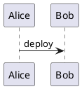

# Overview

Start **carefully**, run `sync_job.run()` and read
[the target page](https://wiki.example.test/wiki/spaces/SYNTH/pages/84/Target)
or [the vendor docs](https://example.com/docs).
Second line.

Ask @Alex Example.

- [ ] pending step
- [x] done step

3. third
4. fourth
   1. nested

[Code: deploy.py]

```python
def deploy(target_env):
    return target_env < 2 and "ok"
```

> [Info]
>
> Keep the **service** online.
>
> - check health

[Expand: Rollback]

Revert the release.

[Status: APPROVED] by the board.

[Jira: OPS-7]

[Diagram: plantuml]



[Included from: Shared Contacts]

## Contacts

Page the on-call engineer.

[Unrendered macro: jira]

Diagram: [Image: flow.png — release flow]

[File: checklist.pptx]

| Region | Item | Qty |
| --- | --- | --- |
| North | a \| b | 1 |
| North | first <br> second | 2 |
| Total | Total | 3 |
[Table: merged cells repeated]

<table>
<tr><th>Step</th><th>Command</th></tr>
<tr><td>Restart</td><td><pre>systemctl restart app</pre></td></tr>
</table>

[Unrendered macro: mystery-plugin]

Injected **macro** output.

End of page.

[Unrendered macro: html]
